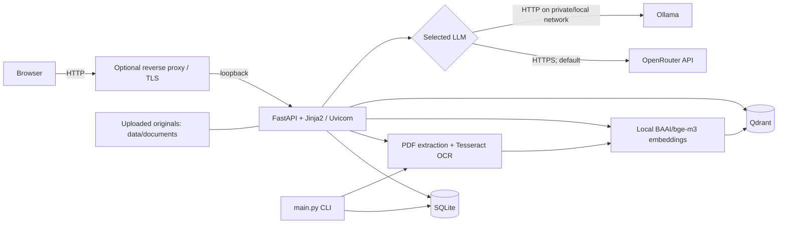

# Deployment Requirements

This document describes the repository as inspected on 2026-10-16. It separates
repository facts from capacity estimates and identifies work that must be done
before a public production deployment. Resource estimates are planning starting
points, not measured service-level requirements.

## 1. Project summary

Georgian Document RAG extracts text from Georgian PDF documents, indexes the
content for semantic search, and answers questions in Russian with page
citations. It has a CLI and a server-rendered FastAPI/Jinja2 web interface.

The backend is Python 3.12. The web layer uses FastAPI, Starlette, Uvicorn, and
Jinja2; persistence uses SQLAlchemy 2 and Alembic; PDFs use PyMuPDF; OCR uses
Tesseract via `pytesseract`; local embeddings use Sentence Transformers and
PyTorch; semantic search uses Qdrant; LLM requests use `httpx` with either
OpenRouter or Ollama. The browser UI consists of HTML templates, CSS, and a
small JavaScript file. There is no separate frontend build.

The ingestion path is synchronous: read a PDF, extract native text or render
pages at 300 DPI for Georgian/English OCR, normalize and chunk the text, write
page/chunk records to SQLite, and upsert vectors to Qdrant. The query path
embeds a question locally, searches Qdrant, builds untrusted-source context,
calls the selected LLM, and validates page citations. SQLite and Qdrant writes
are not one atomic transaction; the pipeline has recovery logic for an
indexing failure.

`main.py` provides `preflight` and `index <pdf>`. The web entry point is
`app.web:app`, normally served by Uvicorn. `GET /health` is a web-process
liveness check only. There are no background workers, scheduled jobs, queues,
or Redis integration in the repository. Upload/indexing and chat messages run
synchronously within web requests.



## 2. Components and dependencies

| Component | Purpose | Technology | Required | Where it runs |
|---|---|---|---|---|
| Application/backend | CLI, web routes, ingestion and RAG orchestration | Python 3.12, FastAPI, Uvicorn | Yes | Application host |
| Web UI | Document upload/list and question forms | Jinja2, HTML, CSS, small JavaScript | Only for browser use; CLI remains available | Served by the backend |
| Main relational store | Documents, extracted page text/status, and chunks | SQLite by default through SQLAlchemy | Yes | Local persistent disk, or another SQLAlchemy-supported database only after validation |
| Vector store | Embeddings, chunk payloads, retrieval | Qdrant; default URL `http://localhost:6333` | Yes for indexing and RAG | Same host or a private/managed Qdrant endpoint |
| Embedding model | Local query/document vectors | Hugging Face `BAAI/bge-m3`, configured at 1024 dimensions | Yes | Application process; model files downloaded/cached locally |
| OCR | Text extraction for pages without enough native text | Tesseract with `kat+eng`, `--psm 3` | Yes for OCR fallback; preflight currently requires the configured language data in all cases | Application host |
| LLM | Russian grounded response generation | OpenRouter by default, or explicitly selected Ollama | Yes for non-empty-context answers | External API, or local/private Ollama |
| Reverse proxy / TLS | Public HTTPS termination and forwarding to loopback | Not included; Nginx/Caddy are deployment choices | Recommended for a private deployment; required for public HTTPS | Application host or edge host |
| Object storage | Off-host originals/backups | Not configured | No; useful for off-host backups at scale | Managed service if selected |
| Redis/message broker/workers | Asynchronous jobs | Not used | No | Not present |
| Monitoring platform | Metrics/alerting | Not configured | No code integration; operational monitoring is recommended | External or separate service |

No PostgreSQL server is required by the current default configuration. There is
no Dockerfile/Compose setup, no Node.js manifest, no bundled reverse proxy, and
no automated monitoring or backup service in the repository.

## 3. Project and installed footprint

Measured in this checkout, excluding `.git`, the virtual environment, and
generated caches:

| Item | Measured size | Notes |
|---|---:|---|
| Application source, templates, and static assets | 34 files, about 156 KiB | `app/`; does not include dependencies or data |
| Test source | 23 Python files, about 145 KiB | Not needed in a runtime deployment |
| Pinned dependency manifest | About 2 KiB | `requirements.txt`; dependency installation is much larger |
| Existing local `venv/` | About 1.20 GiB (37,597 files) | Windows environment; not portable to Linux and not a Linux install-size measurement |
| Repository Docker images | None | No Docker build configuration was found |
| Separate frontend build output | None | No Node.js package manifest or build step was found |
| Local `data/` snapshot | About 10.3 MB across 8 files | Developer checkout data, not a representative production dataset |

Expect the Linux Python environment and the downloaded BGE-M3 model cache to
consume multiple gigabytes together; the exact size depends on platform wheels,
model revision, and cache location and must be measured on the target host.
Qdrant storage, uploaded originals, temporary PDF/OCR data, and backups are
additional. CLI-indexed originals are not copied into application storage;
the source file must be retained separately if it is needed later. UI-uploaded
originals are stored under `data/documents/<sha256>.pdf`.

There is no Docker image size to estimate. If operators introduce containers,
their image and layer sizes become additional deployment-specific storage.

## 4. Database requirements

### SQLite

SQLite is the default main database (`DATABASE_URL=sqlite:///data/app.db`). It
stores document records and hashes, page status and extracted text, and chunk
text/metadata. It is an embedded database: no separate DB server is needed.
For a single application host and modest write concurrency, keeping it on the
same host is the simplest supported arrangement. Ensure the `data/` directory
exists, is writable by the service account, persists across deployments, and
is on local SSD/NVMe rather than a shared network filesystem.

SQLite allows concurrent readers but serializes writes. Document ingestion
updates the database and Qdrant separately, so backups and recovery must
account for both. SQLite is suitable for an initial single-host installation;
the source does not establish a tested migration path to PostgreSQL. A switch
to another SQLAlchemy-supported engine requires testing the schema migration,
database URL, concurrency behavior, and operational recovery first.

### Qdrant

Qdrant stores 1024-dimensional cosine vectors and payloads containing document,
page, chunk, and text data. The application creates/validates its collection
and payload indexes. The default URL is local, but `QDRANT_URL` and optional
`QDRANT_API_KEY` support a remote endpoint. It may run on the same VPS for a
small installation or remotely as a private/managed service. A remote service
can isolate memory/disk pressure and simplify service-level backups, but it
adds network latency and provider cost.

Qdrant is a separate service/process, not the application database. If it runs
locally, configure a persistent storage directory and monitor its disk and
memory; the repository does not supply a Qdrant service definition or backup
configuration.

### Placement and sizing answers

1. **Can SQLite be used instead of a database server?** Yes. It is already the
   configured default; there is no separate relational database server.
2. **Is a separate PostgreSQL server needed?** No, not for the current default
   architecture or a small single-host deployment.
3. **Does Qdrant need a separate server?** No. A local Qdrant process or
   private/managed remote instance is supported by the URL-based configuration.
4. **What are the single-VPS limits?** CPU, memory, disk I/O, and maintenance
   are shared; SQLite serializes writes; a host failure takes down the app,
   SQLite, and local Qdrant together. There is no built-in auth, HA, queue, or
   automated backup.
5. **When split services?** Split Qdrant or move SQLite only after measurements
   show memory/disk contention, sustained write blocking, unacceptable
   tail-latency, or a need for independent availability/backup boundaries. No
   user-count threshold can be derived from source alone.

**Sizing:** a small co-located SQLite database has no separate CPU/RAM
allocation; reserve disk for its actual growth and backup. Qdrant has no fixed
minimum derivable from the repository: point count, payload, index settings,
concurrency, and storage configuration determine its footprint. Its resource
needs must be measured with representative documents. If it is remote, its
resources are not part of the application VPS estimate.

Alembic has one current revision, `20261006_01`, which creates the chunk table
and page-number unique index defensively. Run migrations before serving
traffic. The downgrade drops the chunk table and index; do not use it as a
routine rollback without a verified backup and a review of the data it removes.

## 5. CPU and RAM profiles

These are planning estimates for **one application host**, a single Uvicorn
worker, local CPU embedding, local Tesseract, local SQLite, and local Qdrant.
The LLM provider is remote unless noted. The project has no benchmark from
which to certify throughput.

| Profile | CPU | RAM | SSD/NVMe | Intended use and constraints |
|---|---:|---:|---:|---|
| Minimum / trial | 2 vCPU | 4 GiB (8 GiB safer) | 40–60 GiB | Test or very small private use; remote LLM required for a comfortable margin. Local BGE-M3 plus Qdrant/OCR may pressure 4 GiB; do not run concurrent indexing and question workloads without measurement. |
| Recommended start | 4 vCPU | 8 GiB | 120 GiB | Small single-host production, modest collection, one indexing operation at a time and low concurrent question traffic. Remote OpenRouter avoids local LLM inference memory. |
| Growth headroom | 8 vCPU | 16 GiB | 250 GiB or more | More parallel ingestion/query work or a larger local cache; still not an HA design. If Ollama is co-located, measure model residency and inference peaks before setting capacity. Large corpora need additional disk or separated storage. |

The local embedding model and PyTorch are likely to dominate application memory
and installed size; Qdrant index/cache, PDF rendering/OCR, and concurrent
requests add pressure. Embedding is local in both provider modes. OpenRouter
uses remote compute and does not consume VPS inference RAM, but still uses
application CPU/RAM for PDF parsing, retrieval, and HTTP handling. Local Ollama
adds model storage, RAM, and CPU/GPU demand; its exact requirement depends on
the selected model/quantization and concurrency and is not included as a fixed
number above. A GPU is not required by the code, and no GPU benchmark or
configuration is present.

Web upload/indexing and question answering are synchronous. More simultaneous
requests increase thread/process memory and CPU contention; setting multiple
Uvicorn workers also loads model/service state per process. Start with one
worker, then benchmark before increasing workers. Processing at 300 DPI may
create large temporary page images; unusually large or complex PDFs can peak
well above normal usage.

## 6. Storage estimate

### Fixed and variable storage

No production corpus size is configured. Use the following planning ranges and
measure actual deployment files:

| Category | Initial planning allowance | How to size it |
|---|---:|---|
| Linux OS and system packages | 8–15 GiB | Depends on distro, updates, and installed OCR packages |
| Python environment, application, and model cache | 5–10+ GiB | The checkout's Windows venv is 1.20 GiB; Linux wheels and BGE-M3 cache differ. Reserve space and measure after install/download. |
| Docker layers/images | 0 GiB for the repository as-is | No Docker build is configured; add measured image/layer size only if containers are introduced. |
| SQLite | Dataset-dependent; initially small | Includes document/page records and extracted text/chunks |
| Qdrant | Dataset-dependent | Includes vectors, chunk text payloads, indexes, WAL/segments, and temporary compaction space |
| Uploaded PDF originals | Sum of retained uploads | UI accepts up to 50 MiB per upload; this is a maximum, not an average |
| Temporary processing and logs | Reserve 5–10 GiB | PDF rendering, staging uploads, service logs; configure log rotation externally |
| Backups | At least one full copy of persistent data, preferably off-host | SQLite, Qdrant, and retained originals must be coordinated; backup size grows with dataset |

The 300-DPI rendered page is used to calculate the page hash and as an OCR
input; pages and temporary upload staging are not documented as a persistent
image archive. The SQLite page text and chunks and Qdrant payloads do retain
text, so text has multiple stored representations.

### Per-document planning formula

For an illustrative estimate only, assume an average PDF of **2 MiB** and
**50 chunks per document**, each up to the configured 1000 characters. One
1024-element float32 vector is:

`1024 dimensions × 4 bytes = 4,096 bytes = 4 KiB per vector (raw)`

So the raw vector bytes per assumed document are `50 × 4 KiB = 200 KiB`.
Reserve **3× raw vector bytes** for vector storage plus index/metadata/payload
overhead: about 0.59 MiB per document. This 3× multiplier is a conservative
planning allowance, not a measured Qdrant factor; actual Qdrant storage depends
on version, index configuration, payload, and segment/compaction state. Allow
about 0.1 MiB/document for extracted and chunk text in SQLite and payload
bookkeeping. The estimated active dataset is therefore:

`per document ≈ 2 MiB original + 0.1 MiB SQLite/text + 0.6 MiB Qdrant = 2.7 MiB`

`active dataset ≈ document count × average original size + SQLite text + Qdrant vectors/index/payload`

The estimate excludes unusual PDFs, logs, the OS, Python/model cache, and
temporary processing peaks. The default CLI does not preserve original PDFs;
the original-size term applies only when originals are retained, such as UI
uploads. Do not count the same Qdrant payload as a separate additional full
copy beyond the 3× vector allowance above.

| Planning scenario (not actual corpus size) | Assumed chunks/vectors | Active dataset estimate | With one full backup copy plus 20 GiB base and 30% free capacity |
|---:|---:|---:|---:|
| 1,000 documents | 50,000 | About 2.6 GiB | About 33 GiB |
| 10,000 documents | 500,000 | About 26 GiB | About 96 GiB |
| 100,000 documents | 5,000,000 | About 264 GiB | About 728 GiB |

The last column is `(20 GiB base + 2 × active dataset) × 1.30`, rounded up.
The 20 GiB base is an explicit planning allowance for OS, installed runtime and
model cache, and operating margin; it is not a measured Linux deployment.
Store operational backups off-host even if local temporary backup space is
also reserved. If originals are not retained, recalculate without their
contribution; if average PDF size, chunks/document, or model/index settings
differ, substitute those measured values. At 100,000 documents, a single VPS
and local backup are not an economical default; use separate persistent
storage and tested backup/restore procedures.

## 7. Growth and corpus scenarios

The preceding scenarios assume 2 MiB originals and 50 chunks/document. The
repository does not specify document counts, average page count, document
length distribution, or average chunks/document. Replace those assumptions
with a sample of real Georgian PDFs before purchasing capacity.

| Corpus size | Documents / vectors under assumption | Approximate active data | Likely planning implication |
|---:|---:|---:|---|
| 1,000 | 1,000 / 50,000 | 2.6 GiB | Co-located SQLite and Qdrant can be a reasonable starting point; keep an off-host backup. |
| 10,000 | 10,000 / 500,000 | 26 GiB | A 120 GiB SSD leaves room under the stated assumptions for base files, one local copy, and headroom; monitor Qdrant RAM/disk and SQLite writes. |
| 100,000 | 100,000 / 5,000,000 | 264 GiB | Plan at least about 728 GiB if one backup copy is also kept on the same disk; prefer off-host backup and separately sized storage/services. Benchmark retrieval and ingestion. |

For a more accurate calculation, collect original PDF bytes, pages/PDF,
normalized text bytes/page, chunks/document, Qdrant collection disk usage,
SQLite size, peak RAM during embedding/OCR, and documents indexed per hour.
Storage is not just raw vectors: Qdrant payloads include chunk text and IDs,
and index/segment metadata, WAL, and compaction can add substantial overhead.
The 3× allowance above is only a planning factor, not a guaranteed bound.

## 8. Remote server requirements

### Required for the current implementation

- Python 3.12 is the repository's declared runtime. Install a matching Linux
  interpreter and virtual environment; no Node.js runtime is needed.
- Install the Tesseract executable and `kat` and `eng` language data. The
  configured default is `TESSERACT_LANGUAGES=kat+eng`.
- Use a Linux filesystem with persistent writable storage for the SQLite file,
  Qdrant data, uploaded originals, model cache, and temporary processing.
- Permit outbound HTTPS for package installation/model download and for
  OpenRouter when selected. Local Ollama/Qdrant traffic must stay on loopback
  or a private network.
- Configure all environment settings using `.env.example` as the variable
  inventory. Important secrets are `OPENROUTER_API_KEY` and, for an
  authenticated remote Qdrant endpoint, `QDRANT_API_KEY`.
- Create the configured SQLite parent directory before startup and grant the
  dedicated, unprivileged service account read/write access only to required
  application data and model-cache directories.
- Resolve the Linux dependency issue before installing: `requirements.txt`
  pins `pywin32==312` without a platform marker. `pywin32` is Windows-specific;
  a Linux installation from this file must be tested and this dependency list
  corrected or a Linux-specific install manifest prepared before deployment.
  This documentation-only task does not modify dependencies.

### Recommended for a remote/private deployment

- Prefer Linux x86-64 for initial deployment because the development
  environment and native ML/OCR dependencies are not validated here on Linux
  or ARM. ARM support is unverified; confirm wheel availability for Python,
  PyTorch, tokenizers, and all pinned packages before selecting it.
- Ubuntu Server 24.04 LTS x86-64 is a practical operator choice, not a platform
  declared or tested by the repository. Any supported Linux distribution must
  provide Python 3.12, Tesseract and its language data, and compatible native
  Python wheels.
- Run Uvicorn on `127.0.0.1:8000` behind Nginx/Caddy or a trusted private
  ingress. The documented web UI has no user authentication or authorization;
  its Origin check is not authentication. Do not expose it to the public
  internet as-is. Restrict access to VPN/private network/IP allow-list or add
  approved authentication before broad exposure.
- For public HTTPS, configure a domain/DNS record to the proxy and a valid TLS
  certificate. The app itself does not provide TLS or certificate renewal.
- Keep SQLite, Qdrant, and Ollama ports off the public interface. Use an
  encrypted secret store or tightly permissioned environment file; never put
  real secrets in source control.
- Use synchronized system time (NTP) for reliable logs, TLS, and provider
  request diagnostics. UTC is a sensible server/logging standard; no specific
  application timezone setting is present.

### Ports and firewall

| Traffic | Port | Exposure |
|---|---:|---|
| SSH administration | 22 by default | Restrict to operator addresses/management network; actual SSH port is host-configured |
| HTTP for redirect/certificate validation | 80 | Public only if needed by chosen proxy/certificate method |
| HTTPS | 443 | Public only if this UI is appropriately access-controlled |
| Uvicorn | 8000 | Loopback only (`127.0.0.1`), not public |
| Qdrant HTTP API | 6333 by default | Loopback/private network only |
| Ollama HTTP API | 11434 by default | Loopback/private network only |

Allow only required outbound destinations: DNS, operating-system/package
repositories, Hugging Face model files when downloading/updating the embedding
model, and OpenRouter HTTPS when selected. If Ollama is used, its installation
and model download need outbound access, but application requests can stay
local. No public inbound database port is required.

## 9. External services and operating costs

| Service | Purpose / required? | Configuration | Cost drivers and alternatives |
|---|---|---|---|
| OpenRouter | Default LLM provider; required for answers when selected | `LLM_PROVIDER=openrouter`, `OPENROUTER_URL`, `OPENROUTER_API_KEY`, `OPENROUTER_MODEL` | Provider/model pricing, input/output tokens, request volume, and retries allowed by configured policy. No tariff is estimated here. Ollama is an architectural alternative but requires local hardware and explicit provider selection. |
| Ollama | Optional local LLM provider | `LLM_PROVIDER=ollama`, `OLLAMA_URL`, `OLLAMA_MODEL` | No remote LLM API charge for local inference; hardware, power, model storage, and operations cost remain. It must be installed and the configured model available. No automatic fallback exists. |
| Hugging Face model download | Fetches local `BAAI/bge-m3` model; local embedding is required | `EMBEDDING_MODEL`, `EMBEDDING_SIZE`; standard model cache | No embedding API is called by this code. Initial download requires internet and disk. License/redistribution terms must be checked for the chosen model/revision. |
| Qdrant | Required vector database; local or remote | `QDRANT_URL`, `QDRANT_API_KEY`, `QDRANT_COLLECTION` | A remote/managed instance may be billable by provider capacity/storage/traffic. Local Qdrant avoids a managed-service bill but consumes VPS memory, disk, and operations time. |
| SQLite | Required relational database; embedded default | `DATABASE_URL` | No separate DB service charge; local SSD, backup, and maintenance are still required. No managed SQLite service is configured. |
| Object storage / monitoring / backup | Not integrated or configured | None in application settings | Optional provider charges depend on stored bytes, requests, retention, and egress. An off-host backup destination is recommended; no prices are asserted. |

OpenRouter receives user questions and retrieved document context. The app does
not persist questions, answers, prompts, retrieved context, or raw model
responses, but the selected provider applies its own data handling and
retention. Review its terms and data policy before sending sensitive documents.
`main.py preflight` checks only that an OpenRouter key is configured; it does
not validate the key, account balance, or make a billable test request.

## 10. Security and operations

- **Authentication:** no application login or authorization is implemented.
  Origin checking on state-changing forms does not protect against
  unauthenticated access. Keep access private or gate it using an approved
  authentication/access-control layer before public use.
- **TLS and secrets:** terminate HTTPS at a reverse proxy; store API keys
  outside source control with restrictive file/secret-store permissions.
  Never place key values in this document, logs, command history, rendered
  HTML, or static assets.
- **Network isolation:** expose only the proxy and controlled SSH. Bind
  Uvicorn, Qdrant, and Ollama to loopback/private interfaces. Require TLS and
  authentication on remote Qdrant as supported by its deployment.
- **Upload controls:** current UI accepts `.pdf` uploads up to 50 MiB and
  checks a PDF signature. Apply proxy-level request/body/time limits as well;
  compressed or complex PDFs can require much more processing memory than
  their upload size.
- **Rate limits:** the application does not configure request rate limiting.
  Add it at a trusted edge, especially for uploads and chat messages. Chat
  messages have a 2000-character limit, but no per-user quota or authentication.
- **Logging:** no production log rotation policy is supplied. Configure
  journald or an external log collector with rotation, access restrictions,
  and retention. Do not log keys, prompts, document text, or raw model
  responses; the app's LLM failure logs are designed to omit those values.
- **Backups:** no automated backup is included. Encrypt and store backups
  off-host, define retention, and periodically test a full restore. Back up
  SQLite, Qdrant, and retained originals to a coordinated recovery point.
- **Monitoring:** monitor `/health` for process liveness, plus actual
  dependency readiness via `main.py preflight`; `/health` does not test
  SQLite, Qdrant, Tesseract, embeddings, or the LLM. Track disk/free space,
  RAM/swap, CPU, Qdrant health/storage, SQLite write errors, ingestion
  failures, request latency, and provider rate/credit failures.
- **Updates:** pin/review dependencies, test OS/Python/package upgrades and
  Alembic migrations on a backup or staging copy, then deploy. Keep rollback
  artifacts and backups. The project has no automatic migration-on-start
  deployment mechanism.
- **Documents and privacy:** uploaded PDFs are persisted in
  `data/documents/`; page/chunk text is stored in SQLite and chunk text is
  also sent to Qdrant. CLI source PDFs are not retained by the application.
  Define retention/deletion and access policy for originals and derived text.
  Delete actions remove application records, matching Qdrant vectors, and
  uploaded originals, but not matching files under `data/input/`.
- **Time and data consistency:** SQLite and Qdrant are not atomic. Quiesce
  ingestion while taking coordinated backups or record service snapshots
  with a common recovery point. Verify file hashes and document/vector
  correspondence after restore.

## 11. Deployment procedure

This is a host-based deployment plan; there is no repository Docker setup.
Commands below are limited to commands represented in the project
documentation, using Linux interpreter/module invocation where appropriate.
Do not proceed to production until the Linux dependency manifest issue above
has been resolved and tested.

1. **Prepare the VPS and OS.** Select Linux x86-64, provision an SSD volume
   sized from Section 6, patch the OS, create a dedicated non-root service
   account, configure SSH restrictions, firewall, and time synchronization.
   Success: only intended management/web ports are reachable.
2. **Install system prerequisites.** Install Python 3.12 and venv support,
   Tesseract plus `kat` and `eng` language data, and native libraries required
   by the selected Python wheels. Confirm Tesseract languages before app
   preflight. Critical issue: verify/correct the unmarked `pywin32` dependency
   for Linux. Success: a clean Linux environment can install all pinned
   dependencies and import the application.
3. **Get the source.** Deploy a reviewed release/revision into a stable
   application directory, not a developer checkout. Create a Python 3.12
   virtual environment and install the validated dependency set. No frontend
   build is needed. Success: `app.web` and CLI import without errors.
4. **Set configuration and storage paths.** Create a protected environment
   file based on `.env.example`; set an absolute persistent SQLite URL, private
   Qdrant endpoint, selected LLM, and secret keys. Create/chown the SQLite
   parent directory, upload directory, temporary directory, and model cache.
   Success: service account can read config and write only intended paths;
   no secret is tracked or world-readable.
5. **Start data/vector services.** Provision SQLite as local persistent disk
   and start Qdrant locally with its data directory on a persistent volume, or
   configure a private remote endpoint and API key. Ensure the selected LLM
   provider is reachable; install the configured Ollama model if using Ollama.
   Success: Qdrant is reachable from the application and not from the public
   internet.
6. **Run schema migrations.** From the release directory and with the
   production environment loaded, run `python -m alembic upgrade head`.
   Back up an existing SQLite file first. Success: Alembic reaches the head
   revision and the document, page, and chunk tables are present.
7. **Validate runtime dependencies.** Run `python main.py preflight` using
   the release environment. It verifies the database schema, Qdrant
   reachability, selected LLM configuration/model, and Tesseract languages.
   Success: it prints `Preflight passed.` This command does not prove that a
   model can load successfully or that OpenRouter credentials are valid.
8. **Run application and ingestion.** Start one Uvicorn worker with
   `python -m uvicorn app.web:app --host 127.0.0.1 --port 8000` under a
   process supervisor (systemd is an operator choice, not supplied here).
   There are no workers or schedulers to start. Test CLI ingestion with
   `python main.py index <pdf>` on a controlled sample, or use the web upload.
   Success: the document is listed and expected pages/chunks/vectors exist.
9. **Configure reverse proxy and HTTPS.** Point a domain/DNS record to the
   proxy, obtain/renew a TLS certificate, and forward only to
   `127.0.0.1:8000`. Preserve the correct Host/forwarded headers and set
   request size/time limits appropriate for the 50 MiB upload cap. Do not
   publish the unauthenticated UI broadly. Success: HTTPS works and backend
   ports remain private.
10. **Check health.** Request `GET /health` through the intended route; it
    should return `{"status":"ok"}`. Separately rerun `python main.py preflight`
    because `/health` is liveness only. Success: both checks pass.
11. **Exercise user workflows.** Upload a representative small PDF, confirm
    original storage and document/page/chunk records, ask a question with
    citations, verify retrieval against known content, and test document
    deletion. Test a scan that actually requires OCR. Success: outputs and
    citations are grounded in the sample and errors are visible.
12. **Configure backups.** Back up SQLite, Qdrant, and retained PDFs to
    encrypted off-host storage; define frequency, retention, and recovery-point
    objective based on acceptable data loss. Success: an initial backup
    completes and its integrity/manifest is checked.
13. **Configure monitoring and logs.** Set log rotation and alerting for
    process availability, preflight/dependency failures, disk/RAM exhaustion,
    Qdrant growth, failed indexing, and LLM provider errors/rate limits.
    Success: a test alert reaches the operator and log retention works.
14. **Verify reboot and rollback.** Reboot a staging host; ensure the process
    supervisor restarts the app and Qdrant, paths remain mounted, and
    migrations/data survive. Test restoring a backup and rolling back the app
    code against a compatible schema. Success: checks and a representative
    query pass after restart/restore.

## 12. Updates and recovery

For each release, take a verified backup, deploy code into a new release
directory, install only the validated locked dependencies, run
`python -m alembic upgrade head`, then run preflight and smoke tests before
switching traffic. Keep the previous application release available. A code
rollback is safe only if the prior code supports the migrated schema; there is
only one migration revision today, and its downgrade removes chunk data.
Prefer restoring a tested backup over assuming that downgrade is a harmless
release rollback.

For a consistent recovery point, coordinate:

- SQLite `data/app.db` (use a SQLite-consistent backup method; do not copy an
  actively written database blindly).
- Qdrant collection/storage or a supported Qdrant snapshot.
- `data/documents/` originals uploaded through the UI.
- The separately retained source PDFs used by CLI indexing, if needed to
  rebuild the corpus; they are not copied automatically into application data.
- The deployment configuration and release identifier, with secrets backed
  up only in the approved secret store.

If Qdrant is lost but SQLite and originals remain, vectors are derived data in
principle and can be regenerated by re-indexing originals. The repository has
no separate bulk-reindex/restore command, so test the full re-index workflow
and keep source documents. If SQLite or originals are lost, Qdrant payloads
alone are not a complete supported substitute for the relational records and
source PDFs. After restoring, run migrations/preflight, confirm document and
page counts, check Qdrant collection compatibility (1024 dimensions and
cosine distance by default), test representative retrieval/citations, and
compare original-file SHA-256 hashes with stored document hashes.

## 13. Recommended initial configuration

For a small private deployment, start with **one Linux x86-64 VPS, 4 vCPU,
8 GiB RAM, and 120 GiB SSD/NVMe**, one Uvicorn worker, local SQLite, and local
Qdrant on persistent disk. Use OpenRouter initially to avoid local LLM inference
memory, if provider data handling and cost are acceptable. Embeddings still
run locally and BGE-M3 still needs to be downloaded/cached. Retain at least one
encrypted off-host backup of the coordinated SQLite/Qdrant/originals state.

This is an estimate consistent with the 10,000-document illustrative scenario
including one local backup copy and headroom; it is not a throughput guarantee.
A lower-cost trial can use 2 vCPU, 4–8 GiB RAM, and 40–60 GiB SSD with a small
corpus, remote LLM, and off-host backups. For local Ollama, reserve at least
16 GiB RAM as a starting point and measure the selected model's actual peak
memory; model/quantization-specific sizing is unknown.

Keep the app, SQLite, and Qdrant together initially unless measurements or
availability requirements justify splitting them. A managed/private Qdrant
service may be worthwhile when independent backup/availability or local disk
pressure becomes more important than cost. No managed relational DB is
necessary for the initial single-host design.

Suggested persistent layout:

```text
/srv/georgian-doc-ai/
  releases/<release-id>/       application source and virtual environment
  shared/
    .env                       protected runtime settings/secrets
    data/app.db                SQLite database
    data/documents/            retained uploaded PDFs
    qdrant/                    Qdrant persistent storage (if co-located)
    model-cache/               Hugging Face model cache
    tmp/                       bounded temporary processing space
  backups/                     temporary only; authoritative backups off-host
```

Minimum inbound ports are restricted SSH and, only when publishing the
access-controlled interface, HTTPS 443 (optionally HTTP 80 for redirect or
certificate validation). Uvicorn 8000, Qdrant 6333, and Ollama 11434 must not
be publicly reachable. Monitor app health separately from database/vector
health, disk, RAM, CPU, backup age/restore results, and LLM provider errors.

Scale or split services when measured free disk approaches the operating
reserve, backups no longer fit their target window, memory pressure/swap is
persistent, Qdrant retrieval or indexing latency misses the service target,
SQLite write contention affects requests, or required availability exceeds a
single host. The current application has no built-in HA, horizontal scaling,
or asynchronous job system.

## 14. What must be measured before production

- Real corpus average and high-percentile PDF size, page count, proportion of
  scanned pages, and retention period.
- Average and high-percentile chunks per PDF, extracted text size, duplicate
  uploads, and planned corpus growth.
- Linux dependency installation success and actual disk footprint, including
  the BGE-M3 cache and compatible PyTorch/native wheels; resolve the unmarked
  `pywin32` requirement first.
- Peak RAM/CPU and processing time during representative native-text and
  Tesseract ingestion, embedding, concurrent queries, and any Ollama inference.
- Qdrant actual disk/RAM/index overhead, compaction peaks, write/retrieval
  latency, and snapshot/restore duration at target point counts.
- SQLite database growth, concurrent writer behavior, and backup/restore time.
- Expected concurrent users, indexing frequency, query volume, latency targets,
  availability objective, and acceptable data-loss/recovery time.
- OpenRouter model pricing, token consumption, rate/credit limits, data
  retention terms, and monthly request budget; no provider prices are assumed
  here.
- Required authentication/authorization, network exposure, document privacy,
  retention/deletion policy, audit requirements, and jurisdictional controls.
- Backup retention, off-host storage costs, restore-test frequency, and the
  recovery point to use when SQLite and Qdrant snapshots must be coordinated.
